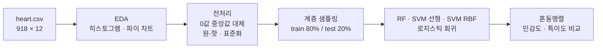
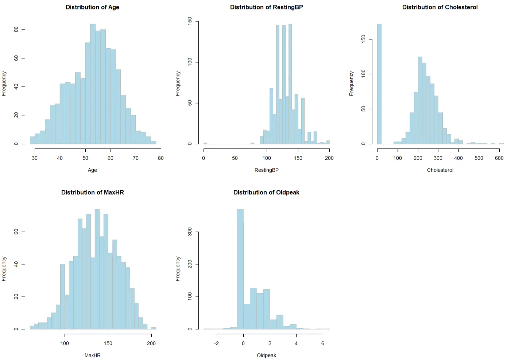
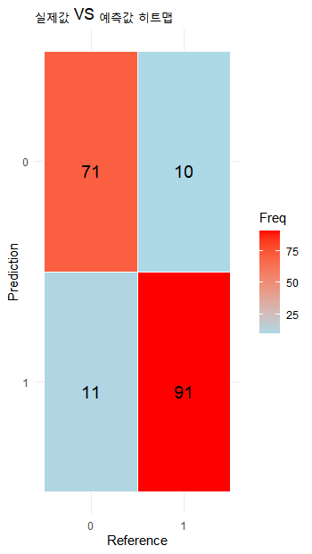
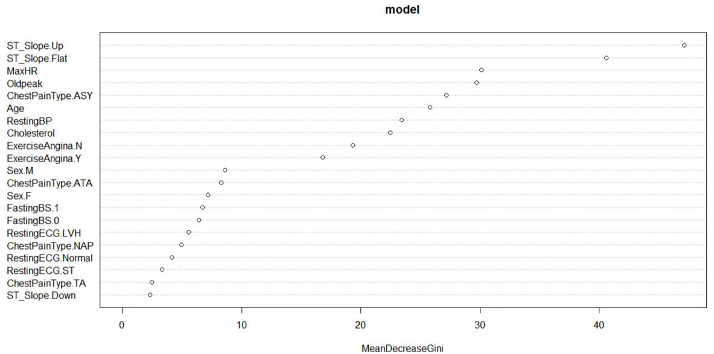

# 머신러닝 모델을 이용한 심장병 여부 예측 (R)

환자의 나이·혈압·콜레스테롤·심전도 등 11개 변수로 심장병 여부를 분류한 R 프로젝트입니다.
랜덤 포레스트, SVM(선형 · RBF), 로지스틱 회귀 네 가지 모델을 같은 데이터 분할로 학습하고 비교했습니다.

## 프로젝트 정보

| 항목 | 내용 |
|---|---|
| 형태 | 머신러닝 수업 4인 팀 프로젝트 |
| 본인 역할 | 팀원과 함께 전 과정 공동 수행 — EDA, 전처리(결측 대체·원-핫 인코딩·표준화·계층 샘플링), 4개 분류 모델 학습과 성능 비교 |
| 사용 기술 | R, caret, randomForest, kernlab, ggplot2 |
| 데이터 | [Kaggle Heart Failure Dataset](https://www.kaggle.com/datasets/tan5577/heart-failure-dataset) · 918명 × 12열 · 심장병 508명 / 정상 410명 |

## 분석 흐름



## 1. 탐색과 전처리



- **콜레스테롤 0 mg/dL이 172건(18.7%)** 있었습니다. 실제로 불가능한 값이라 결측으로 보고, 삭제하면 손실이 커서 0을 제외한 **중앙값(237)** 으로 대체했습니다. 안정 시 혈압 0(1건)도 중앙값(130)으로 대체했습니다.
- 범주형 6개(성별, 흉통 유형, 공복혈당, 안정 시 심전도, 운동성 협심증, ST 기울기)는 `dummyVars()`로 원-핫 인코딩, 연속형 5개는 Z-score 표준화했습니다.
- 타깃 비율(55:45)이 train/test에서 같도록 `createDataPartition()`으로 계층 샘플링했습니다. (train 735명, test 183명)

## 2. 결과 (test 183명 · 정상 82명 / 심장병 101명)

| 모델 | 정확도 | **민감도** (환자 검출) | 특이도 (정상 판별) | 놓친 환자 |
|---|---|---|---|---|
| 랜덤 포레스트 (ntree 500) | **88.5%** | 90.1% | **86.6%** | 10명 |
| SVM 선형 (C = 1) | 87.9% | 89.1% | **86.6%** | 11명 |
| SVM RBF (σ = 0.1) | 87.4% | **92.1%** | 81.7% | **8명** |
| 로지스틱 회귀 | 87.9% | 89.1% | **86.6%** | 11명 |

<sub>민감도 = 실제 심장병 환자 중 심장병으로 예측한 비율, 특이도 = 실제 정상인 중 정상으로 예측한 비율</sub>

| 랜덤 포레스트 혼동행렬 | 랜덤 포레스트 변수 중요도 |
|---|---|
|  |  |

### 해석

- 네 모델 모두 정확도 87~89%로 차이가 작았습니다. 아무것도 학습하지 않고 다수 클래스만 고르는 기준(55.2%)보다 모두 유의하게 높았습니다(p < 2e-16).
- 의료 예측에서는 **환자를 놓치지 않는 것(민감도)** 이 가장 중요합니다. 이 기준에서는 **SVM RBF가 92.1%로 가장 높았지만**, 정상인을 환자로 잘못 분류하는 경우(15명)도 가장 많았습니다.
- 랜덤 포레스트는 정확도와 특이도가 가장 높아 전체 균형이 가장 좋았습니다. 변수 중요도에서는 **ST 분절 기울기, 최대 심박수, Oldpeak, 무증상 흉통(ASY)** 이 상위였습니다.
- 로지스틱 회귀는 계수로 영향 방향을 해석할 수 있었습니다. ST 기울기 Flat(+2.31)이 위험을 가장 크게 높였고, 여성(−1.59)·정상 공복혈당(−1.21)은 위험을 낮추는 방향이었습니다. 확률을 출력하므로 기준값(0.5)을 낮춰 민감도를 더 높이는 방식으로 활용할 수 있습니다.

## 3. 다시 검토하며 고친 점

발표 자료에서는 `confusionMatrix()`의 기본 설정을 그대로 사용했는데, 이 함수는 첫 번째 레벨(`"0"`, 정상)을 positive로 잡습니다.
그래서 출력된 **Sensitivity가 실제로는 '정상인을 정상으로 맞힌 비율'** 이었습니다.

| | 발표 당시 표기 | 실제 의미 |
|---|---|---|
| Sensitivity 86.5% (RF) | 환자 검출률 | 정상 판별률 (특이도) |
| Specificity 90.1% (RF) | 정상 판별률 | **환자 검출률 (민감도)** |

위 결과 표는 발표 당시 혼동행렬 숫자로 다시 계산한 값이며, `heart_disease.R`에는 `positive = "1"`을 지정했습니다.
이 때문에 민감도 기준으로 로지스틱 회귀를 최종 모델로 골랐던 결론도, 실제로는 **SVM RBF가 환자를 가장 많이 찾아내고, 랜덤 포레스트가 가장 균형 잡힌 모델**로 바뀝니다.

### 한계

- 결측 대체값(중앙값)과 표준화 기준(평균·표준편차)을 train/test 분리 **전에** 전체 데이터로 계산했습니다. test 정보가 조금 섞이므로, train에서 계산한 값을 test에 적용하는 방식이 더 엄밀합니다.
- 한 번의 8:2 분할 결과라 모델 간 1~2%p 차이는 분할에 따라 바뀔 수 있습니다. 교차검증으로 비교하는 것이 다음 단계입니다.
- SVM의 C·σ, 로지스틱 회귀의 분류 기준값을 튜닝하지 않았습니다.

## 파일 구성

| 파일 | 내용 |
|---|---|
| `heart_disease.R` | 전체 분석 코드 (EDA → 전처리 → 4개 모델 → 평가) |
| `assets/` | 분석 당시 출력한 그래프 |

`heart_disease.R`은 팀 노션에 기록한 코드 캡처를 옮겨 적은 것이며, 원본과 다른 부분(positive 지정 등)은 `[수정]` 주석으로 표시했습니다.

## 실행 방법

1. Kaggle에서 `heart.csv`를 받아 `data/heart.csv`에 둡니다.
2. R 또는 RStudio에서 실행합니다.

```r
install.packages(c("caret", "randomForest", "kernlab", "ggplot2", "reshape2"))
source("heart_disease.R")
```
